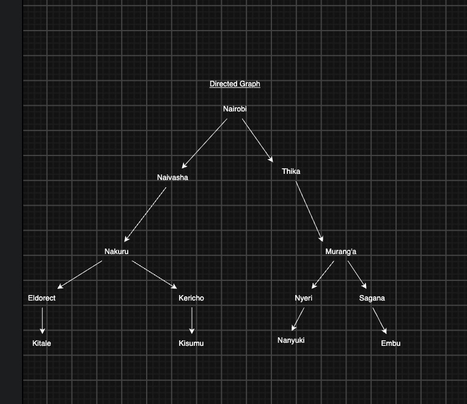
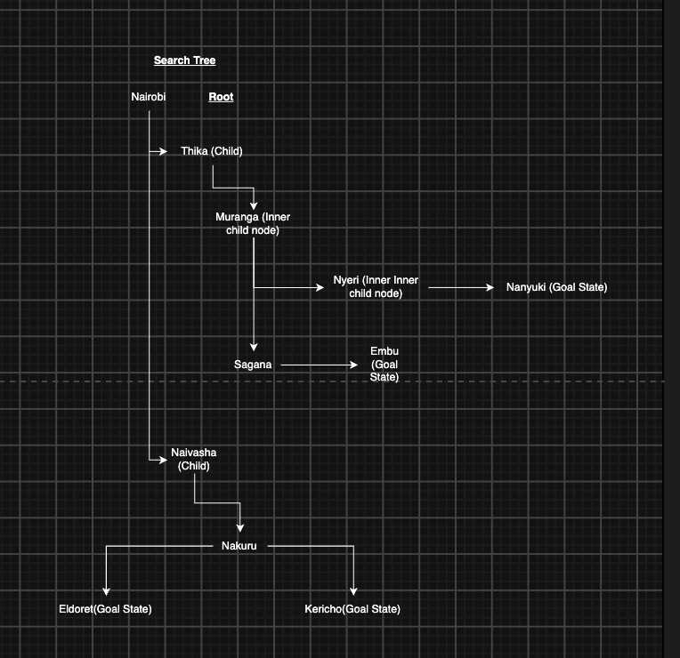

# Artificial Intelligence

## Exercise 3

### Group Members

1. Clifford Chiama - 191259
2. Lawrence Muchiri - 176664
3. Ernest Trevis - 192098

## Question One

- Design the agent using the PEAS framework and further define its environment using the 5 definitions of agent environments.

### Answer

PEAS Description in detail

- Performance Measure - safe cargo delivery, traffic laws, fuel efficiency, passenger and pedestrian safety.
- Environment - local rodas, loading docks, weigh stations and other vehicles.
- Actuator - steering wheel, accelerator, main brakes, trailer breaks
- Sensor - Cameras and Rdar, speedometer, articulation angle prevent the trailer from flipping.

Agent Environments:

1. Partially Observable Agent - The agent cannot see the entire state of the world at once. Its vision is limited by camera and sensor range
2. Stochastic Agent - the environment has a number of variables that may be beyond the agent's control e.g. sudden mechanical failures.
3. Sequential - Current actions affect all future actions and predictions.
4. Dynamic - environment is expected to change as the agent makes an action eg. pedestrians crossing
5. Multi-Agent - environment is shared with other agents as well and the trailer must anticipate and react to them appropriately.

## Question Two

- develop a suitable directed graph and search tree based on the map presented in class of Kenya’s Highway Network featuring cities and towns in the Nairobi, Central Highlands, Rift Valley and Lake Victoria Basin regions. For reference, you can use this Google Maps view to generate the graph and tree. The tree should apply the concept of abstraction as discussed in class. 

### Answer

Backup: See images in the repository. 